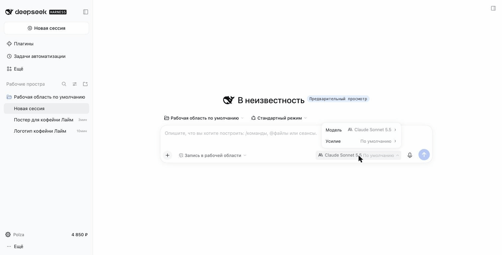
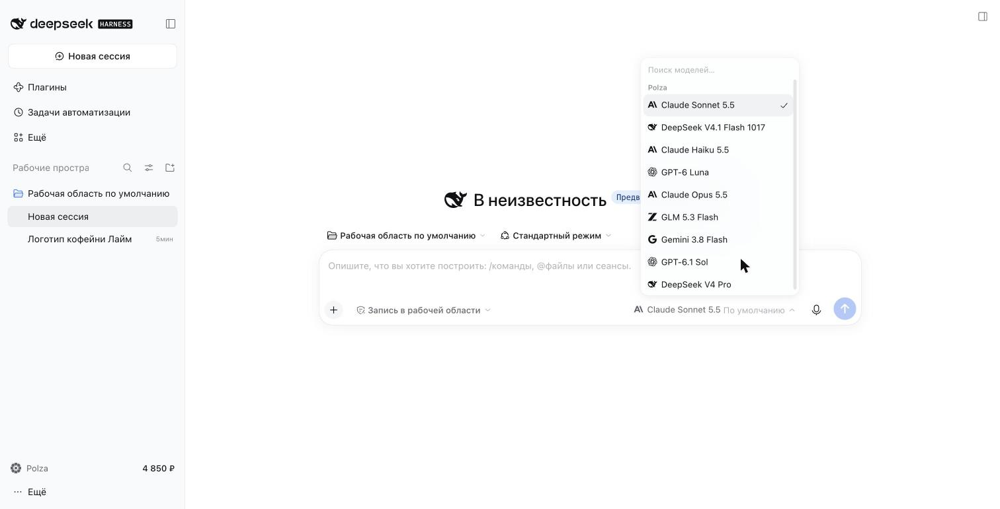
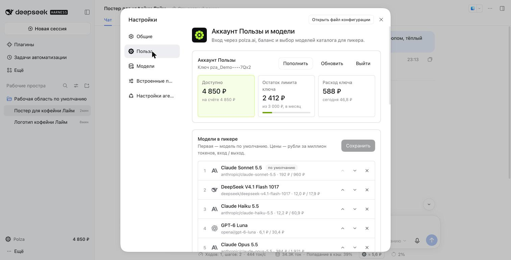
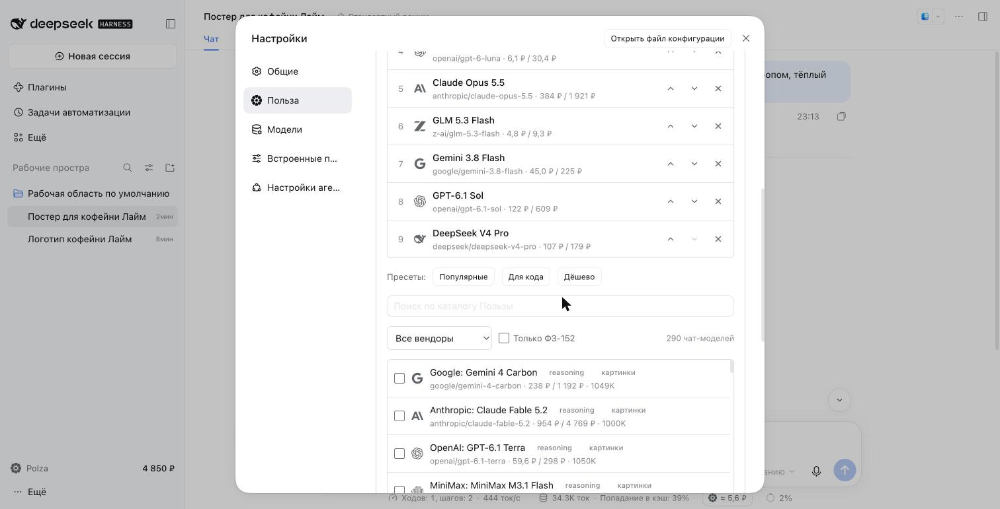
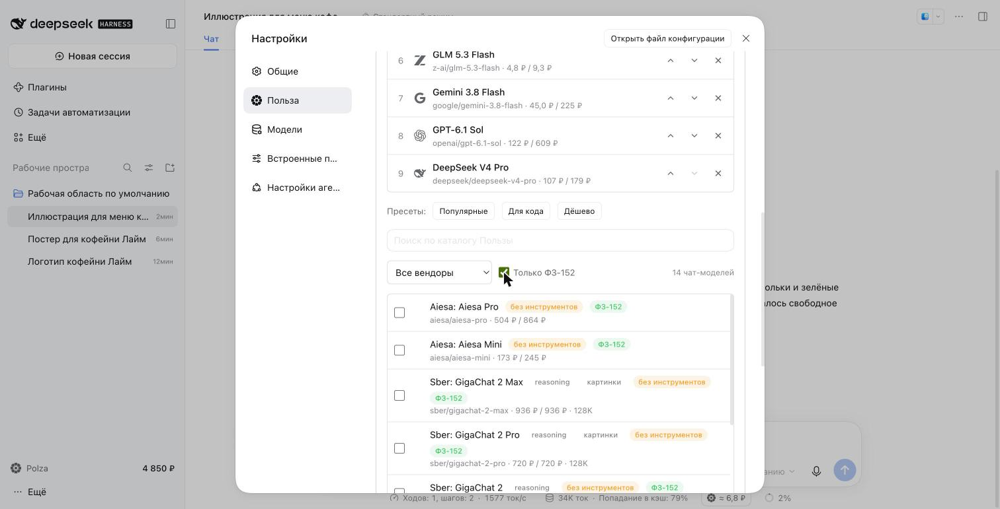
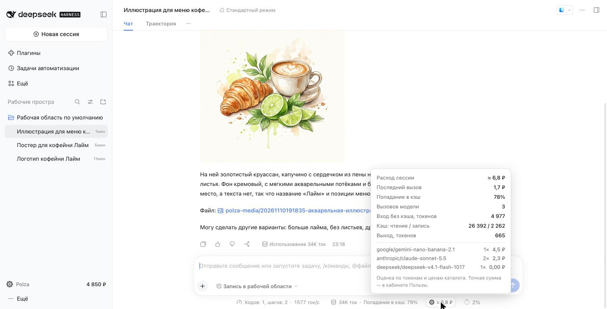
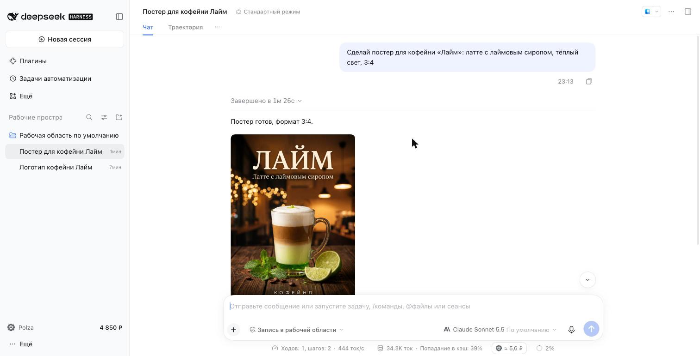
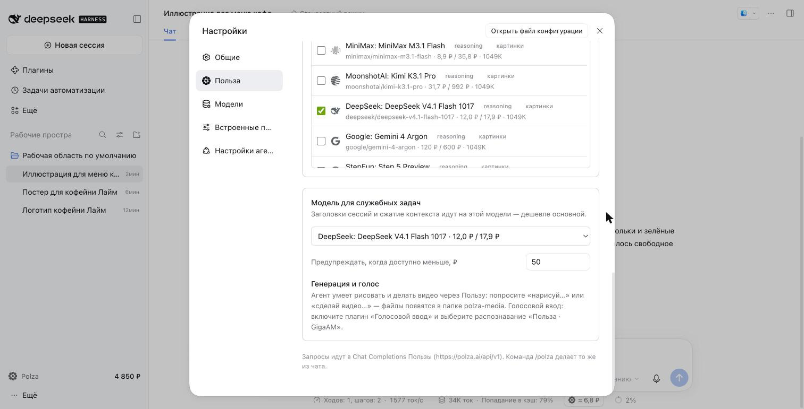
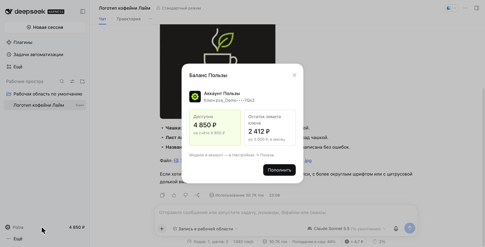

<p align="center">
  
</p>

<h1 align="center">Польза для DeepSeek Harness</h1>

<p align="center">
  290+ моделей Anthropic, OpenAI, Google, DeepSeek, Qwen, Moonshot, Z.ai — с оплатой в рублях через <a href="https://polza.ai">polza.ai</a>.<br>
  Вход аккаунтом Пользы, баланс и расход прямо в интерфейсе, генерация картинок и видео, голосовой ввод на GigaAM.
</p>

<p align="center">
  <a href="https://www.npmjs.com/package/@polza-ai/dsh-plugin-polza"></a>
  
  
</p>



## Установка

В приложении DeepSeek Harness: **Плагины → Добавить плагин** → `@polza-ai/dsh-plugin-polza`, или в терминале:

```sh
dsh plugin --profile desktop add @polza-ai/dsh-plugin-polza
```

Перезапустите приложение, откройте **Настройки → Польза** и нажмите **Войти через Пользу**.

## Что внутри

### Модели Пользы в пикере
Группа **Polza** с иконками провайдеров. Список собирается в настройках — или одним кликом из пресетов
«Популярные», «Для кода», «Дёшево», составленных по реальной статистике Пользы.



### Аккаунт, баланс и модели — в настройках
Баланс организации, остаток лимита ключа, расход. Каталог из 290 моделей с ценами в ₽ за миллион токенов,
поиском, фильтром по вендору и меткой «без инструментов» для моделей, которые агенту не подходят.




### ФЗ-152
Модели, которые обрабатывают данные в РФ по 152-ФЗ, отмечены бейджем — есть фильтр «Только ФЗ-152».



### Расход сессии в рублях
Под полем ввода — сколько стоила сессия. При наведении: последний вызов, попадание в кэш, токены и
разбивка по моделям, включая генерацию картинок.



### Картинки и видео
Агент рисует и делает ролики через Media API Пользы — Nano Banana, GPT Image, Seedream, FLUX, Seedance,
Kling, Veo. Результат появляется в чате, файлы сохраняются в `polza-media/` рабочей папки.



### Экономия на служебных задачах
Заголовки сессий и сжатие контекста идут на дешёвой модели (по умолчанию DeepSeek V4.1 Flash) —
основная модель тратится только на работу.



### Баланс всегда на виду
В футере сайдбара — доступный баланс. Когда денег мало или упёрлись в лимит ключа, плагин предупредит
и предложит пополнить, вместо непонятной ошибки.



### Голосовой ввод на GigaAM
Включите плагин «Голосовой ввод» и выберите службу распознавания **«Польза · GigaAM»** — облачное
распознавание русской речи без установки моделей.

## Команда `/polza`
То же из чата:

| | |
|---|---|
| `/polza login` | вход через polza.ai в браузере |
| `/polza key pza_…` / `/polza logout` | сохранить / удалить ключ |
| `/polza balance` | баланс организации и лимит ключа |
| `/polza models` | модели в пикере с ценами |
| `/polza catalog <поиск>` | поиск по каталогу Пользы |

## Совместимость
DeepSeek Harness 0.2.x. Плагин ежедневно проверяется на новых версиях harness в CI.

## Лицензия
MIT © АО «ПОЛЬЗА.АИ»
