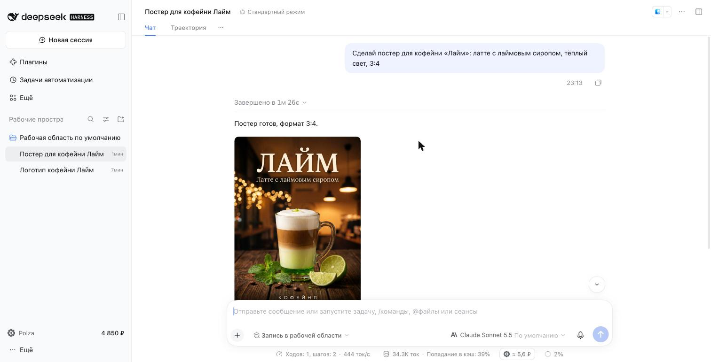
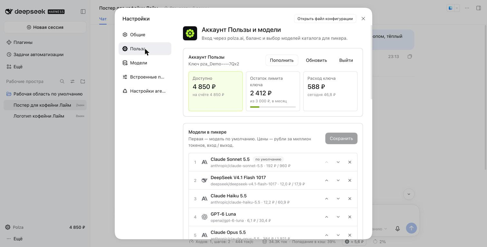
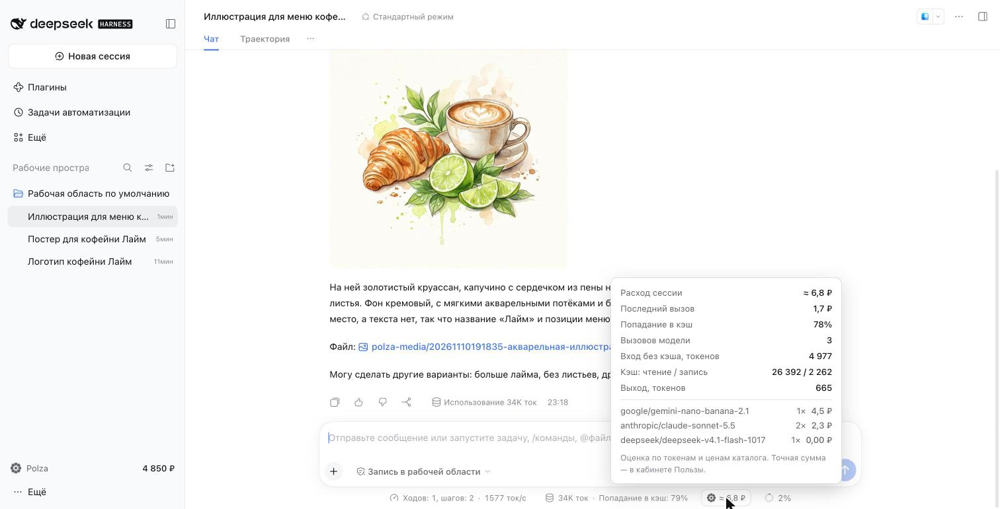

# Polza for DeepSeek Harness

290+ models from Anthropic, OpenAI, Google, DeepSeek, Qwen, Moonshot, Z.ai and others, billed in rubles
through [polza.ai](https://polza.ai). Sign in with a Polza account.

## Features
- **Polza models in the picker** with provider icons, ruble prices and 152-FZ badges.
- **Settings → Polza**: balance, key limit and spend, model selection with catalog search and presets.
- **Session spend in ₽** under the composer: tokens, cache, per-model breakdown.
- **Savings**: session titles and context compaction run on a cheap model.
- **Images and video**: the agent generates them through the Polza Media API; files land in `polza-media/`.
- **Voice input** on GigaAM: enable the Voice input plugin and pick “Польза · GigaAM”.
- **Clear billing errors** with a Top up button.

## Getting started
1. **Settings → Polza → Sign in with Polza**.
2. Choose models for the picker (or a preset). The first is the default.
3. Pick a Polza model under the composer.
