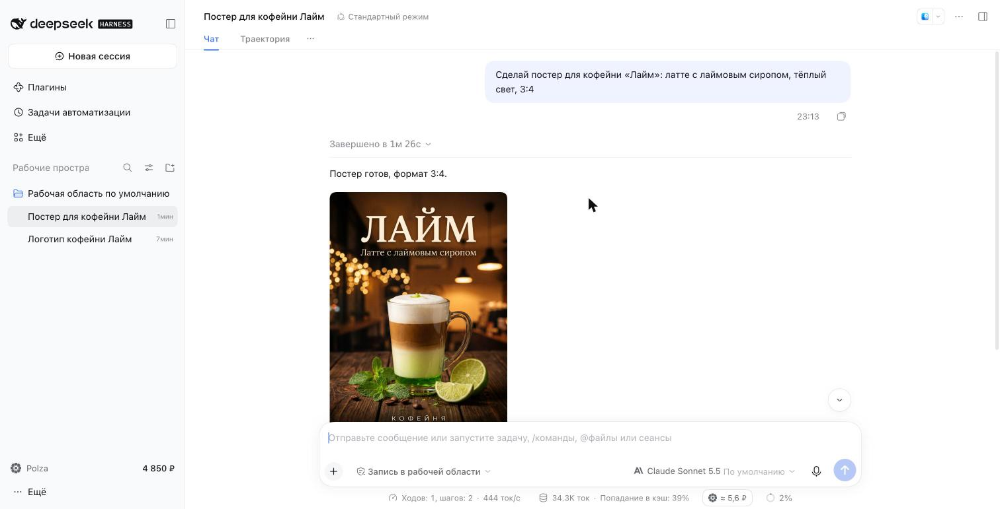
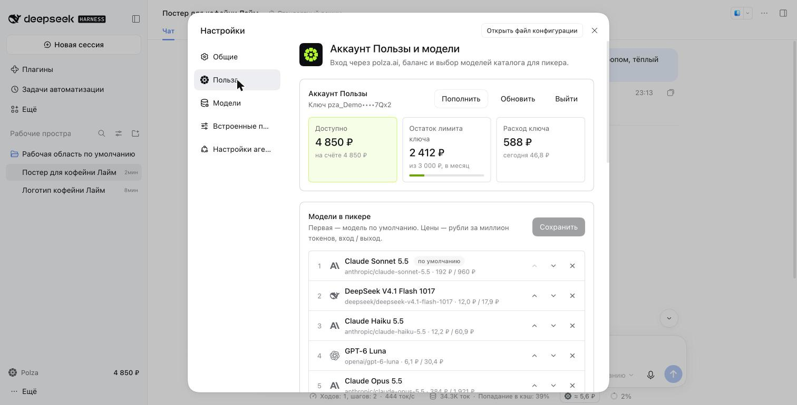
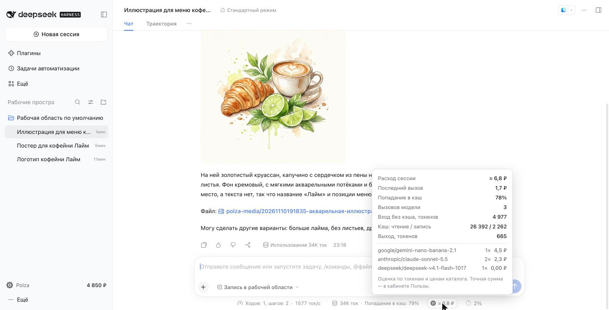

# Польза для DeepSeek Harness

290+ моделей Anthropic, OpenAI, Google, DeepSeek, Qwen, Moonshot, Z.ai и других — с оплатой в рублях
через [polza.ai](https://polza.ai). Вход аккаунтом Пользы, без VPN и зарубежных карт.

## Что умеет
- **Модели Пользы в пикере** — с иконками провайдеров, ценами в ₽ и бейджами ФЗ-152.
- **Раздел «Польза» в настройках** — баланс, лимит и расход ключа, выбор моделей с поиском по каталогу и пресетами «Популярные / Для кода / Дёшево».
- **Расход сессии в ₽** под полем ввода: токены, кэш, разбивка по моделям.
- **Экономия** — заголовки сессий и сжатие контекста идут на дешёвой модели.
- **Картинки и видео** — агент рисует и делает ролики через Media API Пользы (Nano Banana, GPT Image, Seedance, Kling, Veo…), файлы — в `polza-media/`.
- **Голосовой ввод** на GigaAM — включите плагин «Голосовой ввод» и выберите «Польза · GigaAM».
- **Понятные ошибки денег** — при нехватке баланса или лимита ключа сразу видно, что делать, и кнопка «Пополнить».

## Начало работы
1. **Настройки → Польза → Войти через Пользу** — откроется страница согласия polza.ai.
2. Выберите модели для пикера (или пресет). Первая — модель по умолчанию.
3. Выберите модель Polza в пикере под полем ввода.

Из чата то же делает команда `/polza` (`login`, `key`, `balance`, `models`, `catalog`).
